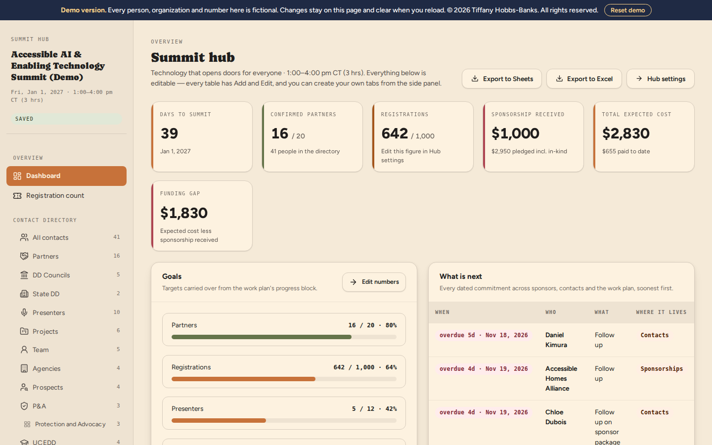
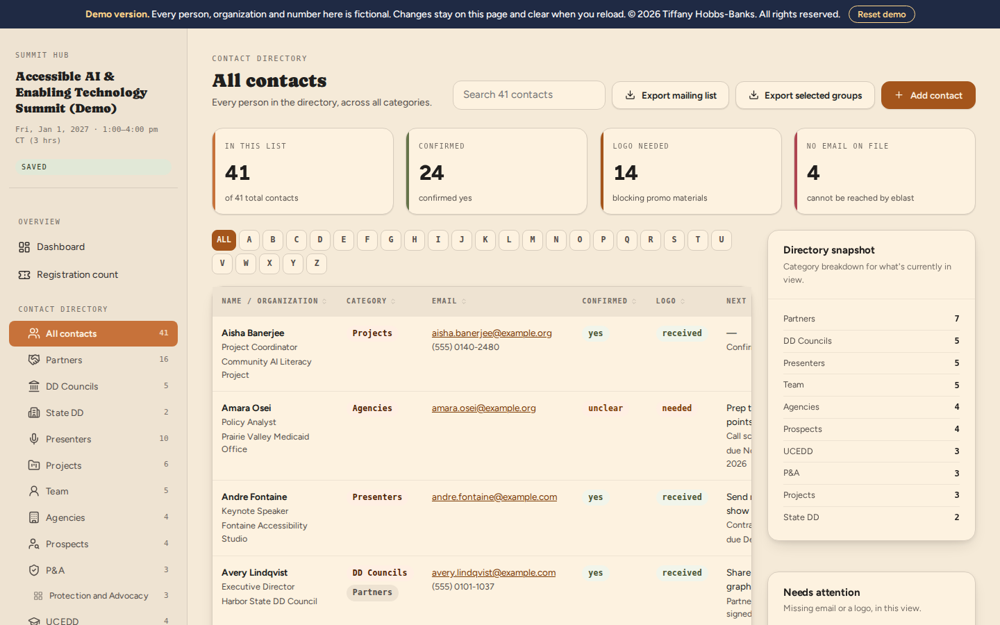
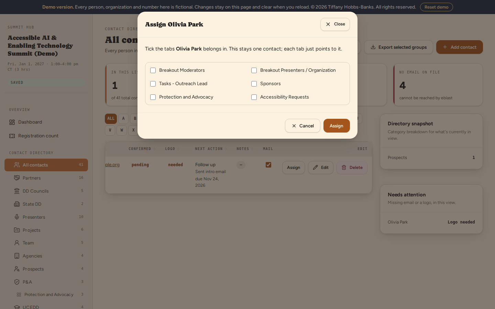
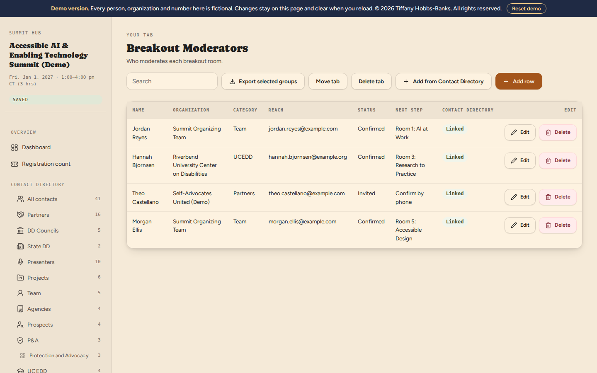
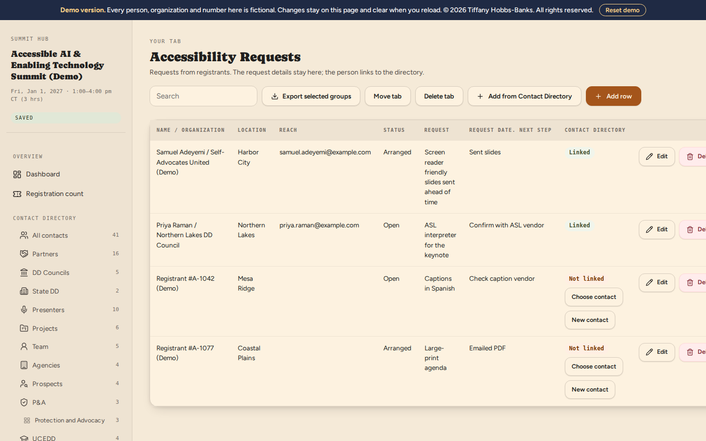
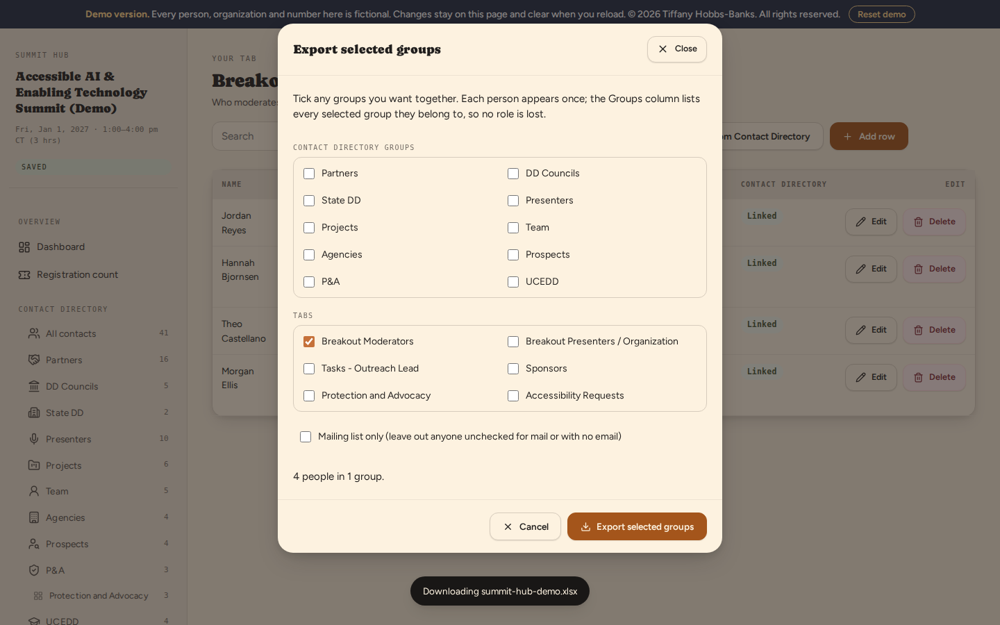
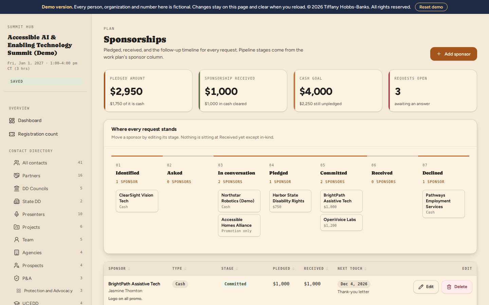

# Summit Hub

**Live demo: [summit-hub-demo.pplx.app](https://summit-hub-demo.pplx.app)**

Summit Hub is the planning app I designed and ran for a national virtual summit on disability and enabling technology. It brought the whole event into one place: contacts, partners, presenters, sponsors, budget, marketing, tasks, the agenda and registration numbers. The planning team used it every day, and everyone saw each other's updates.

The demo runs the same interface with **fictional data only**. Every person, organization, email, phone number and dollar amount is made up. No information from the real summit is included.

## What it did

| Area | What it handled |
|---|---|
| Dashboard | Days to the summit, confirmed partners, registrations, sponsorship received, total cost and funding gap, plus a "What is next" list of every dated follow-up, soonest first, with overdue items flagged |
| Contact Directory | One record per person, with category views (Partners, DD Councils, State DD, UCEDD, P&A, Presenters, Team, Agencies, Prospects, Projects), A to Z filter, search, and missing email and logo flags |
| Custom tabs | Tabs the team created, such as Breakout Moderators, Breakout Presenters, Sponsors and Accessibility Requests. Rows link to the Contact Directory, so a person is selected, not typed twice |
| Assign | Put one contact into several tabs at once. The person stays one record; each tab points to them |
| Export selected groups | Combine several tabs and categories into one spreadsheet. Each person appears once, with every role they hold |
| Goals | Partner, presenter, sponsorship and state agency counts update automatically from the data |
| Planning tools | Sponsorship pipeline, budget, marketing calendar, breakout workshops, tasks, team roles, agenda and event history |
| Exports | CSV per table, full Excel workbook and a Google Sheets copy |

## Built with

Google Apps Script web app with a Google Sheets data store, plain JavaScript, HTML and CSS.

## Screenshots

## Rights

© 2026 Tiffany Hobbs-Banks. All rights reserved. This repository and the demo are shared for viewing only. The source code is not published, and copying, reuse or redistribution of the app, its design or its content is not permitted. See [LICENSE](LICENSE).
